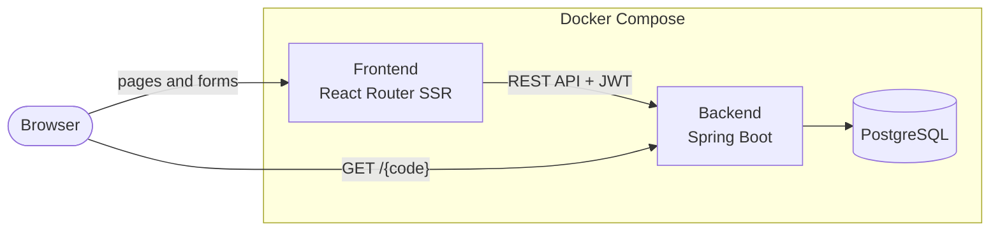
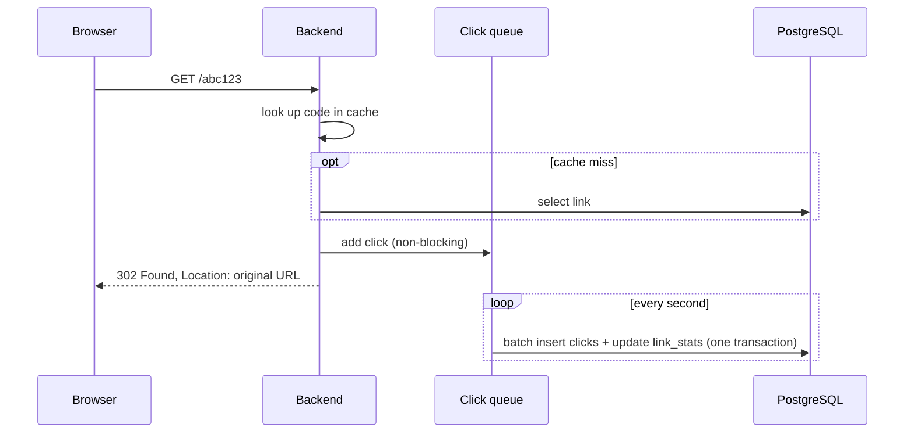

# Shortlink

A URL shortener with click analytics. Create short links (with an optional custom alias and expiry date),
share them as a link or QR code, and see how they perform: clicks per day, unique visitors, referrers,
browsers, operating systems and devices.

Built with Spring Boot 4 (Java 25), PostgreSQL and React Router, and load tested with k6.

## Features

- Shorten any http(s) URL, with or without an account
- Custom aliases (`/spring-sale`) and optional expiry dates
- QR code for every link, downloadable as PNG
- Link management: list, edit target URL and expiry, delete
- Per-link analytics for the last 7, 30 or 90 days; bots and link previews are recorded but not counted
- JWT authentication with access and refresh tokens; only the owner can edit a link or see its stats
- Per-IP rate limits on link creation, login and registration

## Tech stack

| Layer | Technologies |
|---|---|
| Backend | Java 25, Spring Boot 4, Spring Security (JWT), Spring Data JPA, JdbcTemplate, Caffeine |
| Frontend | React 19, React Router 8 (server-side rendering), Mantine, Zod |
| Database | PostgreSQL 16 |
| Testing | JUnit 5, Testcontainers, MockMvc, k6, async-profiler |
| Infrastructure | Docker Compose, Prometheus, cAdvisor (load testing only) |

## Architecture



- **Frontend.** Renders pages on the server and calls the backend API from there. The JWTs are kept in an
  http-only session cookie, so they are never exposed to browser JavaScript.
- **Backend.** A REST API for accounts, links and analytics, plus the public redirect endpoint. JPA is used
  for account and link management; plain JDBC is used on the hot paths (redirect lookup, link creation,
  click inserts and stats queries).
- **Database.** Four tables: `app_user`, `short_urls`, `clicks` (one row per click) and `link_stats` (a
  running click total per link). The schema is generated by Hibernate from the entities.

### Redirect and click recording

A redirect must stay fast even though every click is recorded, so clicks are written in the background:



## Design decisions

**Clicks are recorded asynchronously.** The redirect only adds the raw click to a bounded in-memory queue.
A background task parses the User-Agent, hashes the visitor and inserts the batch every second. The
trade-off: a crash loses at most the last second of clicks, and if the queue fills up (for example while
the database is down), new clicks are dropped instead of slowing down redirects.

**Click totals are maintained per batch.** The `clicks` table is the source of truth. Each batch also adds
its counts to `link_stats` in the same transaction, so the totals cannot drift from the clicks. A popular
link costs one counter update per second instead of one per click, and the links page reads one row per
link instead of counting all its clicks. Period stats (last 7/30/90 days) are aggregated from `clicks`
using an index on `(short_url_id, clicked_at)`.

**Redirect lookups are cached in memory.** Caffeine holds up to 100,000 links, including codes that do not
exist, so repeated requests for unknown codes do not reach the database. Entries are evicted when a link is
created, updated or deleted; updates and deletes evict only after the transaction commits. Load testing
showed backend CPU to be the bottleneck, so an in-process cache was preferred over a network round trip to
Redis.

**No personal data is stored.** Raw IP addresses and User-Agents are never written to the database. Each
click stores the parsed browser, OS and device, plus a salted SHA-256 hash of IP and User-Agent that is
used only to count unique visitors.

**All times are UTC.** The JVM default time zone is set to UTC at startup, so stored timestamps, expiry
checks and per-day statistics do not depend on the host's time zone.

**Client IPs behind a proxy.** The backend reads `X-Forwarded-For` only from private-network addresses,
and the frontend forwards the browser's IP on its server-side calls. Rate limits and visitor hashes
therefore use the real client IP.

## Performance

Load tested with k6 under a fixed resource budget (backend 0.6 CPU, PostgreSQL 0.4 CPU) and profiled with
async-profiler. Each optimization was measured separately; see [loadtest/README.md](loadtest/README.md)
for the method and [loadtest/results/RESULTS.md](loadtest/results/RESULTS.md) for every run.

| Endpoint | Before | After |
|---|---:|---:|
| `POST /api/urls` (create link) | 890 req/s | 1185–1415 req/s |
| `GET /{code}` (redirect, 1M links, Zipf-distributed traffic) | 1295 req/s | 2625–3160 req/s |

These results were measured before click analytics were added.

## Getting started

### Prerequisites

- Docker with Docker Compose
- For development without Docker: Java 25, Maven, Node.js and pnpm

### Run with Docker

```bash
cp .env.example .env
docker compose up -d --build
```

Before starting, fill in the values in `.env`. The most important ones:

| Variable | Description |
|---|---|
| `POSTGRES_PASSWORD` | Database password |
| `JWT_SECRET` | Base64-encoded 256-bit key (`openssl rand -base64 32`) |
| `SESSION_SECRET` | Signs the frontend session cookie (`openssl rand -base64 32`) |
| `ANALYTICS_VISITOR_SALT` | Salt for visitor hashes (`openssl rand -base64 32`) |
| `APP_BASE_URL` | Public base URL of short links, e.g. `http://localhost:4000` |
| `RATE_LIMIT_ENABLED` | `true` by default; set to `false` for load tests |

Once the containers are healthy:

| Service | URL |
|---|---|
| Frontend | http://localhost:8000 |
| Backend API and short links | http://localhost:4000 |
| pgAdmin | http://localhost:5050 |

### Run the tests

```bash
cd backend && mvn verify                  # unit and integration tests (Testcontainers, requires Docker)
cd frontend && pnpm typecheck && pnpm build
```

## API

| Method | Path | Auth | Description |
|---|---|---|---|
| `POST` | `/api/auth/register` | – | Create an account, returns tokens |
| `POST` | `/api/auth/login` | – | Log in, returns tokens |
| `POST` | `/api/auth/refresh` | – | Exchange a refresh token for new tokens |
| `POST` | `/api/urls` | optional | Create a link: `originalUrl`, optional `alias` and `expirationDate` |
| `GET` | `/api/urls` | required | List your links, newest first, with click counts |
| `PUT` | `/api/urls/{code}` | owner | Replace the target URL and expiry |
| `DELETE` | `/api/urls/{code}` | owner | Delete a link and its clicks |
| `GET` | `/api/urls/{code}/analytics?days=30` | owner | Stats for the last 1–365 days |
| `GET` | `/{code}` | – | Redirect (`302`), `404` if unknown, `410` if expired |

## Project structure

```
.
├── backend/             Spring Boot API
│   └── src/main/java/com/urlshortener/
│       ├── controller/  REST endpoints
│       ├── service/     business logic, click recording, analytics
│       ├── entity/      JPA entities (the database schema)
│       └── security/    JWT authentication, rate limiting
├── frontend/            React Router app
├── loadtest/            k6 scripts, capacity finder, profiling script, results
├── monitoring/          Prometheus and PostgreSQL config for load testing
└── docker-compose.yml
```
